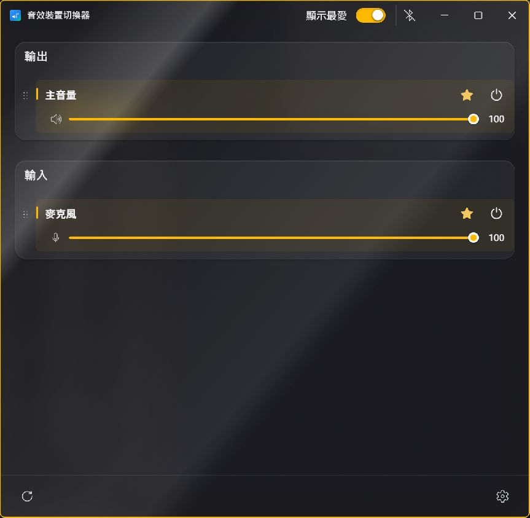
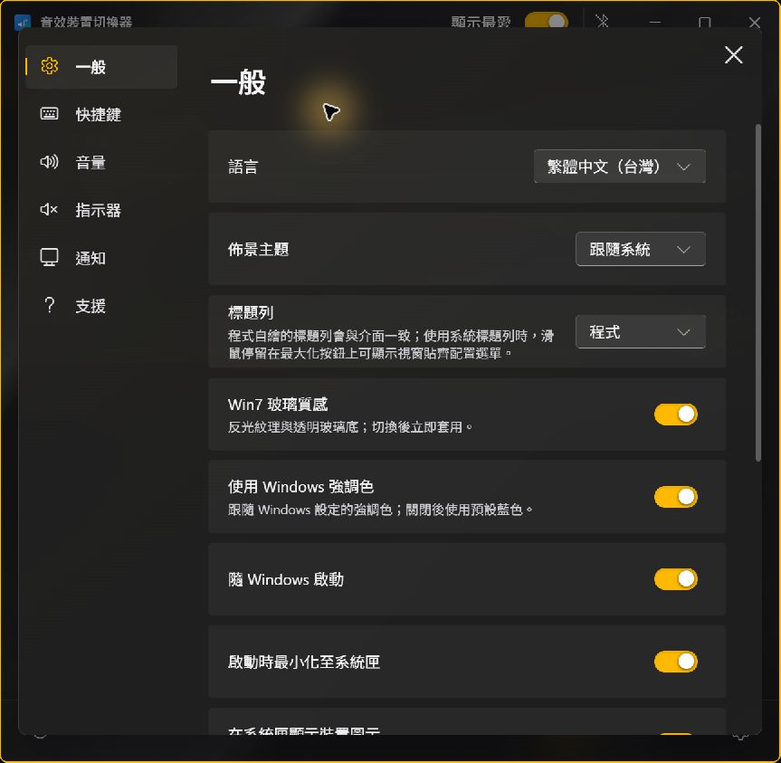
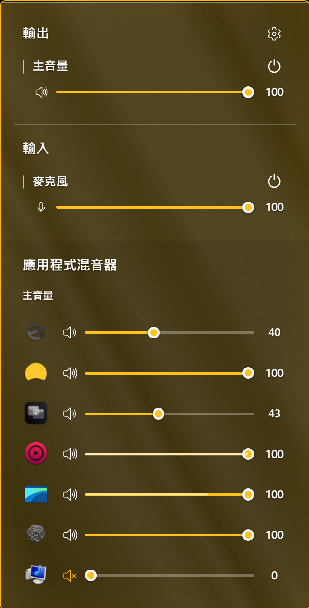
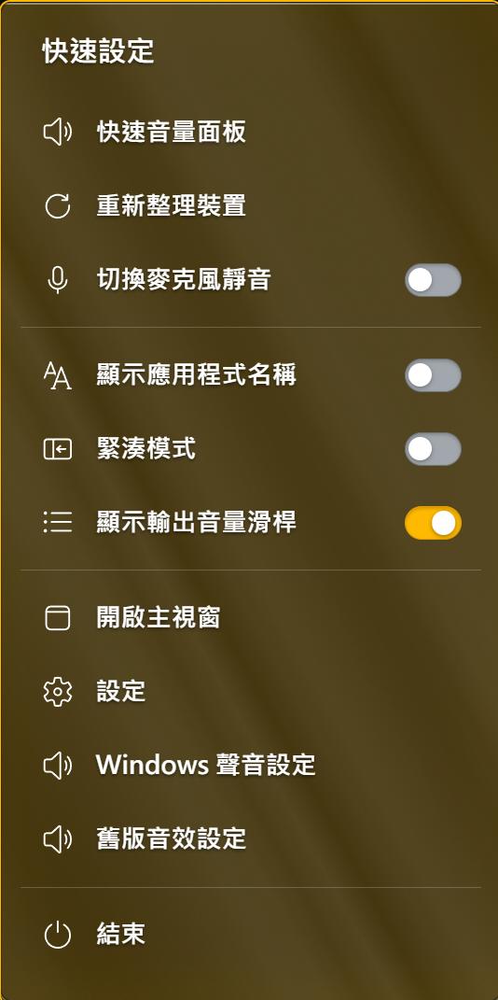

# Fluent Sound Switcher — AuNight Edition

<a href="README.md">繁體中文</a> · <strong>English</strong> · <a href="https://github.com/aunight/fluent-sound-switcher-aunight/releases">Download</a>

  
  
  
  

A Windows customization of [Fluent Sound Switcher](https://github.com/Leocadio94/fluent-sound-switcher). Original developer: Gabriel Leocadio. Modifications and customization: AuNight.

## Screenshots

| Device controls | Settings |
| --- | --- |
|  |  |

| Quick volume panel | Quick settings |
| --- | --- |
|  |  |

## Changes

- Tray panel with enabled audio devices, master volume, app mixer, mute controls and audio-responsive meters.
- Switch an app’s playback device by dragging it to another output device or selecting an output in its context menu. Drag to reorder apps within the same device.
- Rename devices: customize the display names of input and output devices inside the app to identify speakers, headphones, microphones and virtual audio devices.
- Tray app context menu: pin/unpin, mute/unmute, switch output device, ignore apps, restore ignored apps and refresh.
- Dynamic volume meters: show each app’s actual audio level inside its volume slider, with a numeric volume value on the right and speaker icons reflecting volume and mute state.
- Microphone controls: adjust input volume, toggle mute and display a microphone mute-status indicator.
- Process-specific monitoring for LINE call/media helpers, hiding them after silence; fixes for missing system sounds and absent default devices.
- Live Windows light/dark mode, optional Windows 7 glass, a Mica-inspired settings panel, background blur and transitions.
- Traditional Chinese UI, startup and single-instance behavior, and an installer that upgrades registered existing installations. The support page links to this edition's GitHub Releases.

## Install and update

Download the Windows x64 installer from [Releases](https://github.com/aunight/fluent-sound-switcher-aunight/releases). It looks for registered existing installations and retains user preferences. Windows 10/11, Microsoft Edge WebView2 Runtime and .NET Framework 4 are required; process-specific LINE monitoring requires a Windows version supporting process loopback. When WebView2 is missing, the installer uses Microsoft's online bootstrapper.

This edition is unsigned; Windows may show an unknown-publisher or SmartScreen warning. Download new installers from Releases.

## Source and build limitations

`work/` contains the UI patches, C# audio helper, launcher, installer and build scripts. `upstream-reference/` is a snapshot of the original upstream source for reference; it is not the complete source of the customized main executable.

The current main program is built by patching `work/fluent-before-session-order-20261101.exe`, an already-customized binary base, at fixed offsets. That base includes earlier native modifications and cannot be fully reconstructed from the upstream source in this repository. Different base versions or offsets may fail. See [BUILD.md](BUILD.md).

## License and credits

The original project is distributed under the [MIT License](LICENSE), copyright © 2026 Gabriel Leocadio. The full original license is included.

- Original developer: [Gabriel Leocadio (Leocadio94)](https://github.com/Leocadio94)
- Original project: [Leocadio94/fluent-sound-switcher](https://github.com/Leocadio94/fluent-sound-switcher)
- Modified edition: [AuNight](https://github.com/aunight)

