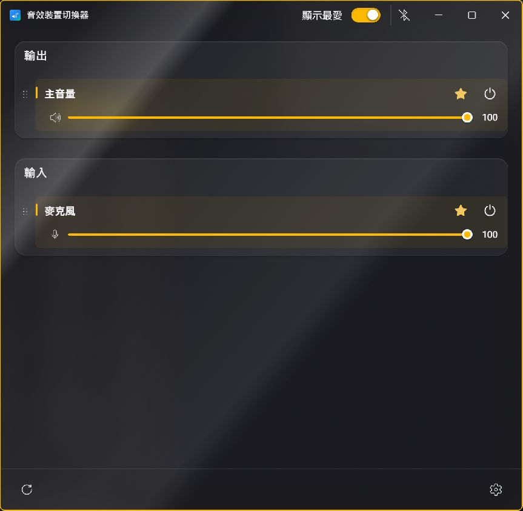
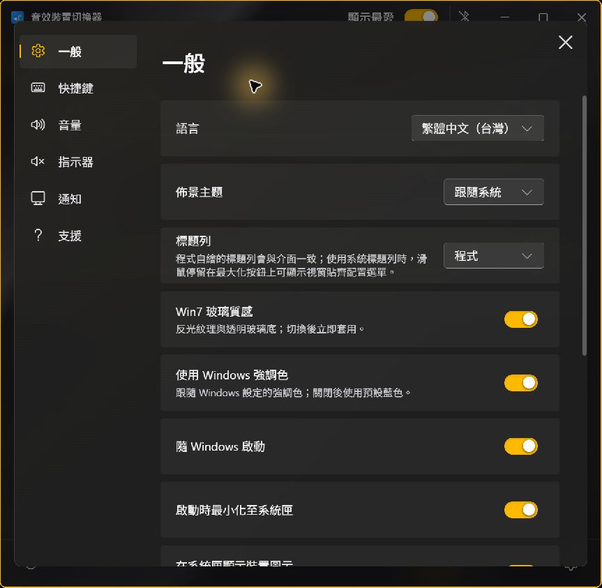
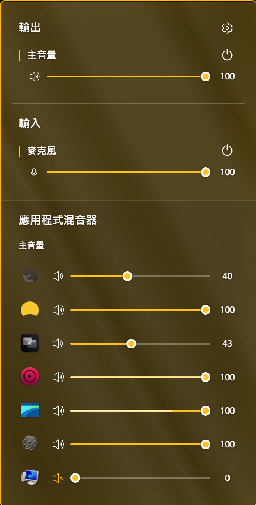
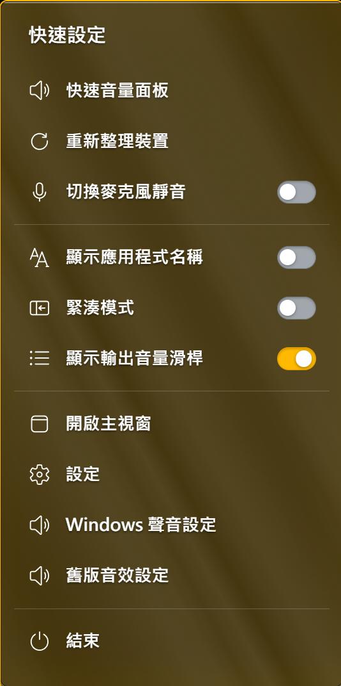
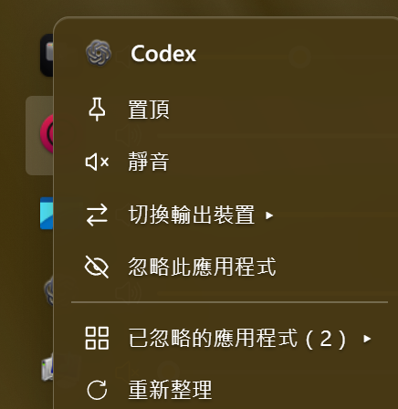
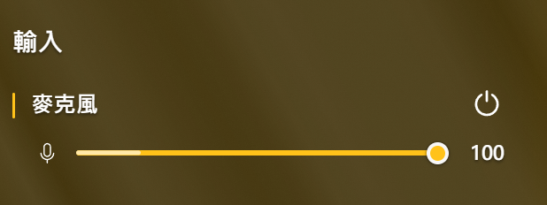

# 音效裝置切換器 — AuNight 修改版

<strong>繁體中文</strong> · <a href="README.en.md">English</a> · <a href="https://github.com/aunight/fluent-sound-switcher-aunight/releases">下載安裝檔</a>

  
  
  
  

音效裝置切換器是 [Fluent Sound Switcher](https://github.com/Leocadio94/fluent-sound-switcher) 的 Windows 修改版。原始開發者：Gabriel Leocadio；修改與客製化：AuNight。

## 截圖

| 裝置管理 | 設定介面 |
| --- | --- |
|  |  |

| 快速音量面板 | 快速設定 |
| --- | --- |
|  |  |

## 修改範圍

- 右下角音量面板：顯示啟用的音訊裝置及已收藏的停用裝置、主音量與應用程式混音器；可以靜音、調音量，並以實際聲音強度顯示音量動畫。
- 快速切換播放裝置：從主視窗或右下角面板切換預設播放裝置，也可為個別應用程式指定輸出；操作方式見下方說明。
- 修改裝置名稱：可自訂輸入與輸出裝置在程式中的顯示名稱，方便辨識喇叭、耳機、麥克風及虛擬音訊裝置。
- 右下角應用程式右鍵功能：置頂／取消置頂、靜音／取消靜音、切換輸出裝置、忽略應用程式、還原已忽略的應用程式，以及重新整理。
- 音量動態條：依各應用程式的實際音訊強度，在音量滑桿內顯示動態電平；右側顯示音量數字，喇叭圖示隨音量與靜音狀態改變。
- 麥克風控制與即時收音電平：可調整輸入音量、切換靜音，並在主視窗與右下角面板的麥克風滑桿內顯示各輸入裝置的即時動態條；靜音或電平資料過期時歸零，另提供靜音狀態指示器。
- LINE 通話及媒體輔助程序使用程序專屬聲音監測，停止出聲後隱藏；修正系統音效遺失與裝置空值造成的錯誤。
- Windows 明暗主題即時同步；提供 Win7 玻璃質感開關、Mica 風格設定面板、背景模糊與動畫。
- 提供繁體中文介面、開機啟動、單一執行個體及覆蓋既有版本的安裝流程。支援頁提供本修改版 Releases 連結。

### 快速切換播放裝置

在主視窗或右下角音量面板選擇輸出裝置，即可切換 Windows 預設播放裝置，方便在耳機、喇叭及虛擬音訊裝置之間切換。主視窗可將常用裝置加入最愛，從快速面板選取，也可設定快捷鍵循環切換。

若只想讓某個應用程式使用另一個播放裝置，在混音器中將該應用程式拖曳至目標輸出裝置，或對它按右鍵，展開「切換輸出裝置」再選擇目的地。例如讓音樂播放到喇叭、通話使用耳機；同一裝置內也可以拖曳調整應用程式排列順序。

清單項目超出視窗或螢幕可用高度時可上下捲動。滑鼠停在清單空白處時，滾輪會捲動清單；停在音量條上時，滾輪會調整該列音量，不需按住修飾鍵，也可直接拖曳滑桿。拖曳排序時以一條細線標示插入位置。

右下角面板會保留已收藏但停用的裝置，可直接按電源圖示重新啟用；未收藏的停用裝置則隱藏。收藏設定不會因停用而被移除。

### 自訂裝置名稱

在主視窗對輸入或輸出裝置按右鍵，選擇重新命名，即可將難以辨認的硬體名稱改成「桌面喇叭」「通話耳機」等名稱。這是程式內的顯示別名，方便在裝置清單與快速面板辨識。

### 應用程式常用操作

在右下角面板的混音器中，對應用程式按右鍵即可開啟以下選單。每個動作針對選取的應用程式操作；「忽略」只影響混音器顯示，仍可透過選單還原。

| 操作 | 用途 |
| --- | --- |
| 置頂／取消置頂 | 將常用應用程式排在該播放裝置的清單前方，取消後恢復一般排序。 |
| 靜音／取消靜音 | 快速切換該應用程式的靜音狀態，方便暫停某個程式的聲音。 |
| 切換輸出裝置 | 展開可用播放裝置清單，將該應用程式的聲音指定到選擇的裝置。 |
| 忽略此應用程式 | 從混音器中隱藏不需要控制的應用程式；這個操作不會關閉程式或將它靜音。 |
| 已忽略的應用程式 | 列出已隱藏的應用程式，選擇「恢復」即可讓它重新顯示。 |
| 重新整理 | 重新讀取目前的音訊工作階段，更新混音器清單。 |

### 音量動態條與麥克風收音

應用程式音量滑桿內的亮色動態條會隨實際播放電平變化，右側數字則表示設定音量，方便區分「設定多大聲」與「現在有沒有出聲」。喇叭圖示也會依音量和靜音狀態變化。

主視窗與右下角面板的麥克風滑桿同樣提供即時收音動態條，對著麥克風說話就能檢查輸入是否有訊號。它讀取各輸入裝置自身的電平，靜音或資料過期時會歸零。面板關閉後會在監測租期結束時釋放收音，音訊不會儲存或上傳。

## 安裝與更新

從 [Releases](https://github.com/aunight/fluent-sound-switcher-aunight/releases) 下載 Windows x64 安裝檔。安裝程式會優先偵測已登錄的既有版本並沿用位置，保留使用者設定。需 Windows 10／11、Microsoft Edge WebView2 Runtime 和 .NET Framework 4；LINE 程序專屬監測需要支援 process loopback 的 Windows 版本。若缺少 WebView2，安裝程式會使用 Microsoft 的線上安裝程式。

此修改版目前沒有程式碼簽章，Windows 可能顯示未知發行者或 SmartScreen 提示。更新請至 Releases 下載新版安裝檔。

## 原始碼與建置限制

`work/` 包含本修改版的 UI patch、音訊輔助程式 C# 原始碼、啟動器、安裝腳本及建置腳本。`upstream-reference/` 是原專案來源快照，供參考；它不是本修改版已編譯主程式的完整原始碼。

目前的主程式是由 `work/fluent-before-session-order-20261101.exe` 這個已客製化的基底套用固定位置的 UI 修改而成。此二進位基底含較早的原生修改；倉庫不宣稱能從上游原始碼完整重建該基底。修改 offsets 或使用其他版本的基底可能導致建置失敗。請參考 [BUILD.md](BUILD.md)。

## 授權與署名

原始專案依 [MIT License](LICENSE) 授權，原始著作權 © 2026 Gabriel Leocadio。隨附完整原始授權文字。

- 原始開發者：[Gabriel Leocadio（Leocadio94）](https://github.com/Leocadio94)
- 原始專案：[Leocadio94/fluent-sound-switcher](https://github.com/Leocadio94/fluent-sound-switcher)
- 本修改版：[AuNight](https://github.com/aunight)

### 裝置進階設定

在「設定 → 音訊裝置」選擇輸出或輸入裝置，可調整預設取樣率／位元深度、獨佔控制及優先權、驅動提供的音效增強，以及輸出裝置的 Windows Sonic 空間音效。選單與開關沿用 Fluent 控制項，並加入各區塊圖示。

44.1／48 kHz 為常用選項，另列出驅動查詢得到的格式；是否能套用仍受裝置、驅動及使用狀態影響。格式變更會保留原格式，失敗時嘗試還原；所有切換均讀回 Windows 狀態驗證。未提供的增強功能不會假裝可用。空間音效目前提供關閉與 Windows Sonic，並保留目前其他格式的顯示；不會代替 Dolby／DTS 授權。

這些是 Windows 裝置設定，不能控制原廠 ASIO 應用程式的音量。SonoBus 使用 MiniFuse ASIO 時，請用 SonoBus 的「輸出電平」。進階設定使用隨附的 SoundVolumeView 免費元件，授權與來源見 [第三方聲明](THIRD_PARTY_NOTICES.md)。

### ASIO 偵測

「設定 → 輸出裝置／輸入裝置 → ASIO 驅動偵測」可查看已安裝驅動、程式載入的驅動，以及有無 Windows 音量工作階段。載入 DLL 不等於正在使用：未取得即時證據時會標為「目前使用未確認」。支援列出 DAW 與 SonoBus 載入的驅動；不再掃描其他程式的介面，也不會把舊設定檔當作目前使用的證據。無 Windows 工作階段的程式會提示在程式或驅動內調整音量。受保護或權限不足的程序可能無法列出。

### 2026.11.06.3

- 裝置設定頁加寬，選單採緊湊單行樣式，格式依 Windows 寫法顯示一次。
- 輸入／輸出頁保留已讀資料，切換頁面不重新掃描；手動重新整理或裝置變更時才更新。
- 系統音效保留在各裝置清單底部，避免工作階段失效造成反覆出現、消失。
- Ableton 原生 ASIO 動態條改讀程式自己的主輸出音量，透過已啟用的本機 Live MCP 橋接；不使用裝置混音冒充個別 APP 音量。SonoBus 原版仍需可用的獨立音量資料來源。
- ASIO 列置底，縮短取樣與畫面更新間隔。
- 加入 GitHub Releases 新版本主動提醒與更新日誌，可稍後提醒或略過該版本；可選擇開啟自動更新，預設關閉。舊版需先手動安裝具備更新功能的版本。

## 最新修改日誌

[查看本次完整中英文更新內容](RELEASE_NOTES.md)。支援頁可查看更新及安裝新版，自動更新預設關閉。
